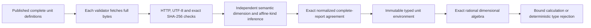

# DimensionalTermKernel

Experimental GenLayer **dimensional and affine quantity algebra**. Published
natural-language unit definitions become a consensus-grounded type environment;
bounded expressions then calculate exact fractions or reject invalid operations.
Not a factual oracle, tariff calculator, graph updater or service certificate.

## Problem and why GenLayer

A distance divided by time is a speed. Two absolute temperature points can be
subtracted into an interval, but cannot be added; an interval may be added to a
point. Treating all temperatures as plain numbers can silently apply an origin
offset to a difference. A normal contract can enforce these rules once unit
meaning is known, but cannot independently interpret origin shifts, intervals,
compound dimensions, negations and exact conversion definitions in prose.

The caller provides source coordinates, raw SHA-256 and requested symbols, never
conversion coefficients, dimension tags, model outputs or source summaries.
Every validator independently fetches the complete committed document and
reconstructs **all** dimensions, exact scales, offsets and point/difference kinds.
Those consequential fields determine which operations execute and their values.
See [GenLayer's nondeterministic boundary](https://docs.genlayer.com/developers/intelligent-contracts/features/non-determinism).

## Architecture and trust boundary



Frontend/backend: previews, UI and source publication. Source: authored unit
definitions. Contract: independent acquisition, interpretation consensus,
immutable environments, rational/type safety and principal-bound calculations.
The fixtures define fictional units, not measurements. Pinning proves a revision,
not factual truth, freshness, SI authority or actual instrument calibration.
Caller-selected numeric values are **hypothetical operands**, not independently
verified observations. No payment, delivery, external asset or agent behavior is
certified. Do not use this prototype for safety-critical measurements.

## Distinct representative mechanism

This is one unit-algebra kernel, not multiple domain variants. It has no owner,
proposal, parent version, graph head, vote, auction, resource allocation,
certificate consumption, account balance or privileged finalizer.

Unlike SourceTariffVM's SKU pricing/rounding program, it infers no rates,
rounding scopes, minima or generated opcodes. Its core is a four-exponent type
algebra with affine points versus linear differences, cross-dimensional products
and exact origin-aware conversion. Unlike SemanticLedgerBridge it matches no
transactions or records. Unlike BoundedPolicyCompiler it enumerates no Boolean
permission table. Unlike OrdinalEndowmentSwap it has no multi-owner consent or
position permutation. Acquisition/signing helpers are shared infrastructure;
these comparisons describe mechanisms, not guaranteed novelty or acceptance.

## Workflow and state

```text
interpret(nonce, pinned source, hash, symbols)
  -> independently fetched and interpreted report
       -> every definition explicit and supported: READY
       -> source fails or any definition UNKNOWN: HELD
       -> malformed AI or validator disagreement: no committed module

READY + bound module root + typed expression
  -> exact result via view
  -> optional immutable principal/nonce calculation record
  -> invalid dimensions, affine operation or root: revert; no record
```

Each source-and-symbol set is examined once per deployment. READY and HELD records
are immutable; there is no model resampling of the same input. A transient outage
can permanently hold that exact set; use a separately published revision when
appropriate. Nothing is locked or owed, so there is no fund-recovery lifecycle.

## Evidence and consensus

Sources are constructed from `OWNER/REPO/FULL_40_HEX_COMMIT/PATH.txt`. Arbitrary
hosts, query strings, mutable branches and path traversal are rejected. Full raw
HTTP-200 bodies must be 1–4096 bytes and strict UTF-8; no truncation or lossy
decode. Raw hashes bind the bytes. The full body, not just its hash, enters every
independent semantic evaluation. Source failure never produces coefficients.

Ordered symbols (2–6) receive complete records: dimension exponents
`[length,time,mass,temperature]`, `LINEAR` or `POINT`, rational scale and offset.
Canonical anchors are metre, second, kilogram and kelvin by protocol definition.
Canonical quantity is `scale * displayed + offset`. POINT is limited to absolute
temperature; even zero-offset kelvin readings are points. Differences are LINEAR
and must have zero offset. Approximate, missing, contradictory or contextual
definitions are UNKNOWN with no coefficients; any UNKNOWN holds the whole set.

Validators refetch and independently derive the full table. Exact equality
covers source status, bytes/hash, context, all exponents, kinds, scales and
offsets. Fractions reduce canonically before comparison. There is no confidence
or approval tolerance. Schema checks supplement, never replace, semantic
re-evaluation. The returned report is validated again before storage.

## Exact algebra

Postfix grammar: integer or rational quantities `150@SPAN`, `1/3@BEAT`, followed
by `+`, `-`, `*`, `/`. At most 31 tokens / 512 characters; no Python eval or code
generation. `_` requests canonical coordinates; a symbol requests conversion.

| Operation | Allowed meaning |
|---|---|
| linear + linear / linear - linear | Equal dimensions only; linear result |
| point + interval / interval + point | Equal dimensions; point result |
| point - interval | Equal dimensions; point result |
| point - point | Equal dimensions; interval result |
| point + point / interval - point | Rejected |
| multiplication / division | Linear quantities only; exponent vectors combine |
| target conversion | Exact dimension **and** point/linear kind match |

Numerators/denominators are bounded, normalized integers, never floats. Division
by zero, stack underflow, unknown units, leftover operands and incompatible
targets revert. The kernel asserts mathematical typing, not physical plausibility
or uncertainty propagation. It does not support approximate/nonlinear units.

Example fetched definitions give SPAN=0.01 metre, BEAT=120 seconds, RATE=metre/sec,
HOT=absolute Celsius-like point, COLD=absolute kelvin point, DELTA=kelvin interval:

```text
150@SPAN 2@BEAT /      -> RATE  = 1/160
20@HOT 5@DELTA +      -> COLD  = 5963/20
30@HOT 20@HOT -       -> DELTA = 10
20@HOT 10@HOT +       -> rejected: point + point
1@SPAN 1@BEAT +       -> rejected: incompatible dimensions
```

## API

`module_key(coordinate,sha,symbols_csv)` computes the deployment-bound input root.
`interpret(nonce,coordinate,sha,symbols_csv)` acquires and interprets once.
`get_module(input_root)` returns immutable full evidence and definitions.
`evaluate(input_root,module_root,expression,target)` is a root-bound read.
`record_calculation(nonce,input_root,module_root,expression,target)` stores the
exact input and result under the native caller. `get_calculation(key)` reads it.
`get_attempt(principal,nonce)` resolves a creator's interpretation attempt.

Every calculation binds contract, actor, nonce, input root, full module root,
exact expression, target and result. Records cannot be overwritten or consumed.
Any caller can evaluate public modules. No caller can mutate another record.
Per-actor caps: 16 definition attempts, 64 recorded calculations. These are
resource bounds, not Sybil resistance. Unlimited read-only reuse remains possible.

## Install and test

```powershell
python -m venv .venv
.venv/Scripts/pip install -r requirements-dev.txt
npm ci --ignore-scripts
.venv/Scripts/genvm-lint check contracts/DimensionalTermKernel.py --json
.venv/Scripts/python -m pytest tests -q
npm run test:unit
npm run test:sdk
```

42 Python tests and four independent JavaScript tests pass, alongside seven SDK
calldata roundtrips and GenVM lint. Tests include direct VM operation, exact-fraction differential checks, malformed
definitions, actual independent callback refetch/reasoning, material coefficient
substitution, source integrity, replay and root substitution. Direct VM mocks
web/LLM and does not prove distributed consensus. A narrow Windows fixture defers
only gltest's open temporary-message unlink error, never contract errors.
The separate JavaScript oracle uses BigInt arithmetic, not the contract Python.

## Deploy and reproduce

```powershell
npm install -g genlayer@0.39.2
genlayer network set studionet
genlayer account use YOUR_ENCRYPTED_TEST_ACCOUNT
genlayer account unlock
genlayer deploy --contract contracts/DimensionalTermKernel.py
genlayer write CONTRACT_ADDRESS interpret --args demo COORDINATE SHA256 SPAN,BEAT,RATE,HOT,COLD,DELTA
genlayer call CONTRACT_ADDRESS get_module --args INPUT_ROOT
genlayer call CONTRACT_ADDRESS evaluate --args INPUT_ROOT MODULE_ROOT '150@SPAN 2@BEAT /' RATE
genlayer write CONTRACT_ADDRESS record_calculation --args speed INPUT_ROOT MODULE_ROOT '150@SPAN 2@BEAT /' RATE
genlayer receipt TX_HASH --stdout --stderr
genlayer code CONTRACT_ADDRESS
```

StudioNet is gasless; send no tokens. Use native encrypted signing; never paste
keys or passwords. The Windows adapter keeps HTTP bodies on pipes, not public
logs. Set `DTK_CLI_PATH` outside this workspace to the installed CLI's dist/index.js.
Process-local signer/network selection does not mutate global configuration.

```powershell
$env:DTK_NATIVE_HTTP='1'
node --require ./scripts/native-http.cjs scripts/complete-proofs.mjs PUBLISHED_FIXTURE_COMMIT
node --require ./scripts/native-http.cjs scripts/verify-live.mjs
```

The serial proof runner journals intent/nonce before sending, persists each hash,
and inspects known receipts rather than resending. Unknown broadcast outcomes
stop for inspection. FINALIZED alone is not execution success. The read-only
verifier checks deployed source equality, receipt outcomes, immutable evidence
roots, every calculation and BigInt arithmetic. No signing occurs during it.

[LIVE_PROOFS.md](LIVE_PROOFS.md) and [SUBMISSION.md](SUBMISSION.md) are generated
only from completed live proof journals. See [architecture](docs/architecture.md)
and [SECURITY.md](SECURITY.md). Experimental, unaudited; no steward acceptance
or universal novelty is guaranteed.
